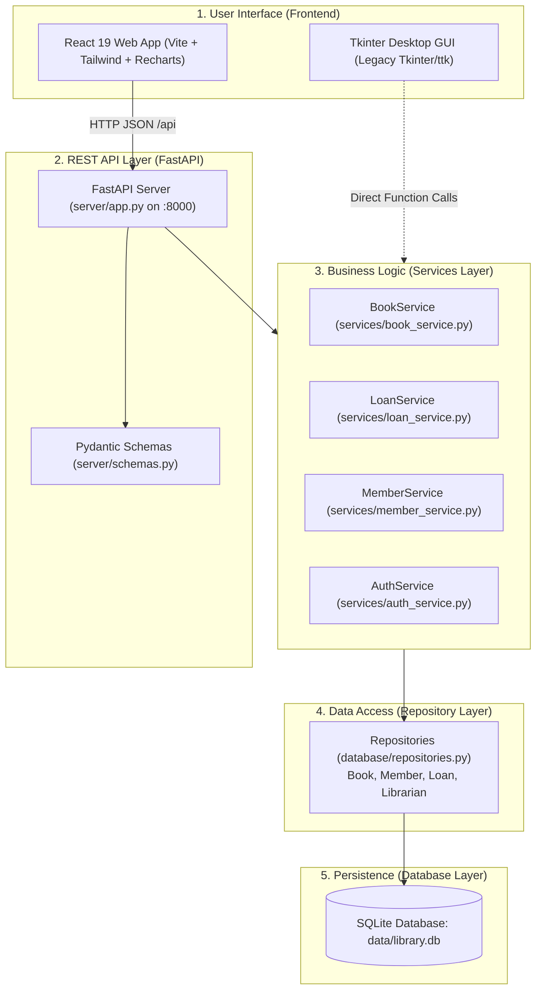

# 🎓 Advanced Python Programming — Core Concepts Guide
### Smart Library Management and Book Analytics System

---

## 📌 Introduction & System Architecture

This guide explains every advanced Python concept implemented in the **Smart Library Management and Book Analytics System**. It is written in simple, clear English to help you understand your code deeply and answer faculty questions with confidence during your viva review.

### Architecture Overview: How the Layers Work Together

The project uses a clean **layered architecture** where every layer has a specific job:



### Explaining the Layers to Faculty:
1. **React Frontend (`frontend/`)**: The client-side visual interface running in the browser. It renders forms, data tables, and interactive Recharts graphs. It does not touch the database directly; it sends HTTP requests.
2. **FastAPI Backend (`server/`)**: The bridge between the web interface and Python logic. It defines REST endpoints, checks input formats using Pydantic, and returns JSON data.
3. **Service Layer (`services/`)**: The "brain" of the application where business rules live (e.g., loan limit of 14 days, max 5 books per member, fine of ₹2.00/day, checking stock before checkout).
4. **Repository Layer (`database/repositories.py`)**: The data access layer. It writes and runs parameterized SQL queries (`?`) to read from and write to SQLite tables.
5. **SQLite Database (`data/library.db`)**: The permanent storage file on disk that holds tables (`books`, `members`, `loans`, `librarians`) with foreign keys and check constraints.

---

## 🏛️ Module I: Object-Oriented Programming (OOP)

### 1. Classes and Objects
- **What it means**: A *class* is a blueprint, and an *object* is an actual instance created from that blueprint.
- **Why it is useful**: Represents real library entities (a physical Book, a Member, a Staff Librarian, or a Loan transaction) with their own data and behaviors.
- **Actual File Path**: `models/book.py`, `models/person.py`, `models/member.py`, `models/loan.py`
- **Class Involved**: `class Book`, `class Person`, `class Member`, `class Loan`
- **Code Example**:
  ```python
  # From models/book.py
  class Book:
      def __init__(self, book_id, title, author, category, price, total_copies, available_copies=None):
          self.book_id = str(book_id).strip()
          self.title = str(title).strip()
          self.author = str(author).strip()
          self.category = str(category).strip()
          self.price = float(price)
          self.total_copies = int(total_copies)
          self.available_copies = int(total_copies if available_copies is None else available_copies)
  ```
- **How it works in the library**: When adding "Clean Code" to the catalog, the system instantiates a `Book` object containing its ID, title, author, price, and available copies.
- **Viva Answer**: "A class defines the properties and behaviors of a domain entity, while an object is a live instance in memory holding specific data."

---

### 2. Encapsulation & Properties (`@property`)
- **What it means**: Encapsulation hides internal data and prevents invalid values from being assigned by using getters and setters.
- **Why it is useful**: Prevents corrupt data, such as a book having a negative price or having more available copies on the shelf than total physical copies owned.
- **Actual File Path**: `models/book.py` (lines 35–64) and `models/person.py` (lines 25–45)
- **Method Involved**: `@property`, `@available_copies.setter`, `@price.setter`
- **Code Example**:
  ```python
  # From models/book.py
  @property
  def available_copies(self) -> int:
      return self._available_copies

  @available_copies.setter
  def available_copies(self, value: int) -> None:
      val = int(value)
      if val < 0:
          raise ValueError("Available copies cannot be negative.")
      if hasattr(self, "_total_copies") and val > self._total_copies:
          raise ValueError("Available copies cannot exceed total copies.")
      self._available_copies = val
  ```
- **How it works in the library**: If code attempts to set `book.available_copies = -5` or `book.available_copies = 20` when `total_copies = 5`, Python raises a `ValueError` immediately.
- **Viva Answer**: "Encapsulation protects object state by routing access through `@property` getter and setter methods that enforce validation boundaries."

---

### 3. Inheritance
- **What it means**: A child class automatically inherits attributes and methods from a parent class.
- **Why it is useful**: Avoids duplicating common personal information (name, email, phone) across students, faculty, and library staff.
- **Actual File Path**: `models/member.py` (line 12) and `models/librarian.py` (line 13)
- **Classes Involved**: `class Member(Person)` and `class Librarian(Person)` inheriting from `Person`
- **Code Example**:
  ```python
  # From models/member.py
  class Member(Person):
      def __init__(self, member_id, name, email, phone, created_at=None, max_books=5):
          super().__init__(name=name, email=email, phone=phone)
          self.member_id = member_id
          self.max_books_allowed = max_books
  ```
- **How it works in the library**: Both `Member` and `Librarian` call `super().__init__()` so they inherit name and contact validation, while adding their own role-specific attributes.
- **Viva Answer**: "Inheritance allows child classes like `Member` and `Librarian` to reuse attributes and validation logic from the base `Person` class."

---

### 4. Polymorphism & Method Overriding
- **What it means**: Polymorphism allows different classes to have methods with the same name that behave differently according to the specific class.
- **Why it is useful**: The application can call `person.get_role_display()` on any user without needing complex `if-else` type checks.
- **Actual File Path**: `models/person.py` (line 62), `models/member.py` (line 33), `models/librarian.py` (line 55)
- **Methods Involved**: Abstract method `get_role_display()` in `Person`, overridden in subclasses
- **Code Example**:
  ```python
  # In models/member.py
  def get_role_display(self) -> str:
      return "Student Member"

  # In models/librarian.py
  def get_role_display(self) -> str:
      return "Administrator" if self.is_admin else "Library Staff"
  ```
- **How it works in the library**: When displaying the user profile in the top-right corner of the interface, the system simply calls `user.get_role_display()`, which automatically returns the appropriate title.
- **Viva Answer**: "Polymorphism lets subclasses provide their own specific implementation of an inherited method, such as `get_role_display()`."

---

### 5. Operator Overloading (`__lt__` and `__add__`)
- **What it means**: Defining how built-in operators like `<` (less than) or `+` (addition) work on custom class objects.
- **Why it is useful**: Enables sorting lists of books directly with `books.sort()` and combining stock counts of identical titles cleanly.
- **Actual File Path**: `models/book.py` (lines 65–75)
- **Methods Involved**: `def __lt__(self, other)` and `def __add__(self, other)`
- **Code Example**:
  ```python
  # From models/book.py
  def __lt__(self, other: "Book") -> bool:
      """Overloads '<' to sort books by price ascending."""
      if not isinstance(other, Book):
          return NotImplemented
      return self.price < other.price

  def __add__(self, other: "Book") -> "Book":
      """Overloads '+' to combine stock quantities of identical books."""
      if not isinstance(other, Book) or self.book_id != other.book_id:
          raise ValueError("Can only combine identical book records.")
      return Book(
          book_id=self.book_id,
          title=self.title,
          author=self.author,
          category=self.category,
          price=self.price,
          total_copies=self.total_copies + other.total_copies,
          available_copies=self.available_copies + other.available_copies,
      )
  ```
- **How it works in the library**: Calling `sorted(catalog)` automatically sorts books from cheapest to most expensive using `<`.
- **Viva Answer**: "Operator overloading maps Python operators like `<` and `+` to special methods like `__lt__` and `__add__` to provide natural object operations."

---

### 6. Special (Dunder) Methods (`__len__` and `__bool__`)
- **What it means**: "Dunder" (double-underscore) methods allow custom classes to integrate with Python's built-in functions like `len()` and `bool()`.
- **Why it is useful**: Calling `len(book)` returns how many copies are currently on the shelf. Defining `__bool__` ensures that an out-of-stock book (`available_copies == 0`) is still treated as an existing object in `if book:` statements.
- **Actual File Path**: `models/book.py` (lines 77–88)
- **Methods Involved**: `__str__`, `__repr__`, `__len__`, `__bool__`
- **Code Example**:
  ```python
  # From models/book.py
  def __len__(self) -> int:
      """Returns number of copies currently available on shelf."""
      return self.available_copies

  def __bool__(self) -> bool:
      """Ensures book evaluates truthy even when available copies is 0."""
      return True
  ```
- **How it works in the library**: `len(book)` quickly reports available inventory; `__bool__` prevents an out-of-stock book from mistakenly evaluating as `False` in conditions.
- **Viva Answer**: "Dunder methods customize how Python built-in operations treat our objects; `__len__` returns shelf stock and `__bool__` ensures correct truthiness."

---

### 7. Class Methods (`@classmethod`) & Static Methods (`@staticmethod`)
- **What it means**: A *class method* receives the class (`cls`) rather than an instance (`self`), often used as an alternative constructor. A *static method* is a regular utility function grouped inside a class without accessing `self` or `cls`.
- **Why it is useful**: Class methods reconstruct model objects directly from SQLite database rows. Static methods hash passwords independently of any specific user object.
- **Actual File Path**: `models/book.py` (lines 90–100) and `models/librarian.py` (lines 35–45)
- **Methods Involved**: `@classmethod from_row(cls, row)`, `@staticmethod hash_password(password)`
- **Code Example**:
  ```python
  # From models/book.py (Class Method)
  @classmethod
  def from_row(cls, row) -> "Book":
      return cls(
          book_id=row["book_id"],
          title=row["title"],
          author=row["author"],
          category=row["category"],
          price=float(row["price"]),
          total_copies=int(row["total_copies"]),
          available_copies=int(row["available_copies"]),
      )

  # From models/librarian.py (Static Method)
  @staticmethod
  def hash_password(password: str) -> tuple[str, str]:
      salt = os.urandom(16).hex()
      pwd_hash = hashlib.pbkdf2_hmac("sha256", password.encode(), bytes.fromhex(salt), 100_000).hex()
      return pwd_hash, salt
  ```
- **How it works in the library**: When SQLite returns a database row, `Book.from_row(row)` instantly turns it into a typed `Book` object.
- **Viva Answer**: "A class method acts as a factory constructor receiving `cls`, while a static method is a self-contained utility function attached to a class namespace."

---

## ⚡ Module II: Functional Programming & Language Features

### 8. Lambda Functions & `filter()`
- **What it means**: `lambda` creates a small, one-line anonymous function. `filter()` takes a function and an iterable, keeping only elements where the function returns `True`.
- **Why it is useful**: Quickly finds all books that have at least one copy ready for checkout without writing multi-line loops.
- **Actual File Path**: `services/book_service.py` (lines 144–149)
- **Function Involved**: `BookService.filter_available_books()`
- **Code Example**:
  ```python
  # From services/book_service.py
  def filter_available_books(self, books=None):
      catalog = books if books is not None else self.get_all_books()
      # filter() keeping only books where available_copies > 0
      return list(filter(lambda b: b.is_available, catalog))
  ```
- **How it works in the library**: Used to filter the catalog down to only titles ready for borrowing.
- **Viva Answer**: "`filter()` applies an anonymous `lambda` predicate across the catalog, returning only books that are currently in stock."

---

### 9. `map()`
- **What it means**: Applies a function to every item in an iterable and returns a stream of transformed results.
- **Why it is useful**: Formats a list of book objects into concise summary strings for notifications or logs.
- **Actual File Path**: `services/book_service.py` (lines 150–155)
- **Function Involved**: `BookService.format_book_summaries()`
- **Code Example**:
  ```python
  # From services/book_service.py
  def format_book_summaries(self, books=None):
      catalog = books if books is not None else self.get_all_books()
      return list(map(lambda b: f"[{b.book_id}] {b.title} ({b.author}) - ₹{b.price:.2f}", catalog))
  ```
- **How it works in the library**: Transforms complex `Book` objects into clean text lines like `[BK-1001] Clean Code (Robert C. Martin) - ₹650.00`.
- **Viva Answer**: "`map()` takes an iterable of books and transforms each item into a formatted summary string without mutating the original collection."

---

### 10. `functools.reduce()`
- **What it means**: Repeatedly applies a function of two arguments cumulatively to a sequence, reducing the entire collection to a single value.
- **Why it is useful**: Calculates the total monetary valuation of the entire library inventory in one clean mathematical fold.
- **Actual File Path**: `services/book_service.py` (lines 156–164)
- **Function Involved**: `BookService.calculate_total_inventory_valuation()`
- **Code Example**:
  ```python
  # From services/book_service.py
  from functools import reduce

  def calculate_total_inventory_valuation(self, books=None) -> float:
      catalog = books if books is not None else self.get_all_books()
      if not catalog:
          return 0.0
      # Accumulator accumulates (price * total_copies) for every book
      total_val = reduce(lambda acc, b: acc + (b.price * b.total_copies), catalog, 0.0)
      return round(total_val, 2)
  ```
- **How it works in the library**: Starts with `acc = 0.0`, multiplies each book's price by its total copies, and sums them into a grand total valuation figure.
- **Viva Answer**: "`reduce()` aggregates an entire catalog into a single monetary number by folding prices and copies across an accumulator."

---

### 11. List, Set, and Dictionary Comprehensions
- **What it means**: Compact, readable Python expressions for constructing lists, sets, or dictionaries from existing collections.
- **Why it is useful**: Replaces bulky 5-line `for` loops with concise, fast expressions.
- **Actual File Path**: `services/book_service.py` (lines 165–182)
- **Methods Involved**: `get_distinct_categories_set_comp()`, `get_stock_lookup_dict_comp()`, `get_low_stock_titles_list_comp()`
- **Code Example**:
  ```python
  # Set Comprehension: extracts unique categories
  categories = {b.category for b in catalog}

  # Dictionary Comprehension: maps book ID directly to available copies
  stock_lookup = {b.book_id: b.available_copies for b in catalog}

  # List Comprehension with if condition: filters titles with <= 2 copies
  low_stock = [b.title for b in catalog if b.available_copies <= 2]
  ```
- **How it works in the library**: Set comprehension eliminates duplicate category names; dictionary comprehension creates an instant $O(1)$ stock lookup table.
- **Viva Answer**: "Comprehensions provide a concise syntax to construct lists, unique sets, and key-value dictionaries from collections in a single line."

---

### 12. Generators (`yield`) & Custom Iterators
- **What it means**: A *generator* is a function that produces values one at a time using `yield`, pausing execution between calls. An *iterator* is an object implementing `__iter__()` and `__next__()`.
- **Why it is useful**: Allows streaming large catalog tables batch-by-batch without loading thousands of records into memory all at once.
- **Actual File Path**: `services/book_service.py` (lines 18–39 and 185–194)
- **Classes & Functions**: `class CatalogIterator`, `def stream_books_generator(batch_size)`
- **Code Example**:
  ```python
  # Generator function using yield
  def stream_books_generator(self, batch_size: int = 5):
      all_books = self.get_all_books()
      for i in range(0, len(all_books), batch_size):
          yield all_books[i:i + batch_size]

  # Custom Iterator implementing the iterator protocol
  class CatalogIterator:
      def __init__(self, books):
          self._books = books
          self._index = 0
      def __iter__(self):
          return self
      def __next__(self):
          if self._index < len(self._books):
              book = self._books[self._index]
              self._index += 1
              return book
          raise StopIteration
  ```
- **How it works in the library**: Calling `for batch in service.stream_books_generator(5):` yields 5 books at a time, conserving system RAM.
- **Viva Answer**: "Generators use `yield` to stream data on demand lazily, while custom iterators implement `__iter__` and `__next__` with `StopIteration`."

---

### 13. Decorators & Higher-Order Functions
- **What it means**: A *decorator* is a function that takes another function, adds behavior to it, and returns it. A *higher-order function* is any function that accepts a function as an argument or returns one.
- **Why it is useful**: Protects administrative endpoints from unauthorized student access without duplicating permission checks across every function.
- **Actual File Path**: `services/auth_service.py` (lines 18–34) and `services/book_service.py` (lines 201–207)
- **Functions Involved**: `@require_librarian`, `filter_by_custom_predicate(predicate)`
- **Code Example**:
  ```python
  # From services/auth_service.py
  from functools import wraps

  def require_librarian(func):
      @wraps(func)
      def wrapper(self, *args, **kwargs):
          user = getattr(self, "current_user", None)
          if not user or not getattr(user, "is_admin", False):
              raise PermissionError(f"Action '{func.__name__}' requires Administrator privileges.")
          return func(self, *args, **kwargs)
      return wrapper
  ```
- **How it works in the library**: Adding `@require_librarian` above a method automatically inspects the active user session and blocks non-librarians.
- **Viva Answer**: "A decorator wraps a function to extend its behavior; `@require_librarian` verifies user roles before allowing protected operations to run."

---

### 14. Closures
- **What it means**: A closure is an inner function that remembers and retains access to variables from its outer enclosing scope, even after the outer function has finished executing.
- **Why it is useful**: Generates custom reusable validation functions on the fly (e.g., loan day limits or price ranges).
- **Actual File Path**: `utils/validators.py` (lines 62–74)
- **Function Involved**: `create_range_validator(min_val, max_val, field_name)`
- **Code Example**:
  ```python
  # From utils/validators.py
  def create_range_validator(min_val: float, max_val: float, field_name: str):
      # Enclosing outer function captures boundaries
      def validator(val: float) -> tuple[bool, str]:
          # Inner function remembers min_val and max_val
          if val < min_val or val > max_val:
              return False, f"{field_name} must be between {min_val} and {max_val}."
          return True, ""
      return validator

  # Usage:
  price_checker = create_range_validator(0.0, 50000.0, "Book Price")
  is_valid, msg = price_checker(450.0)  # Returns (True, "")
  ```
- **How it works in the library**: `price_checker` remembers the min and max numbers given when it was created and uses them to check book prices.
- **Viva Answer**: "A closure is an inner function that remembers variables from its enclosing scope even after the outer function has returned."

---

## 🚀 Module III: Concurrency, Performance & Profiling

### 15. Multithreading vs. Multiprocessing & The Python GIL
- **What it means**:
  - **Multithreading**: Runs multiple threads inside a single OS process sharing memory. In Python (CPython), the **Global Interpreter Lock (GIL)** allows only one thread to execute Python bytecode at a time.
  - **Multiprocessing**: Spawns distinct OS processes, each with its own Python interpreter and independent memory space, completely bypassing the GIL.
- **Why it is useful**: Multithreading is ideal for I/O operations (fetching web APIs, saving files). Multiprocessing is required for CPU-bound computations (calculating mathematical risk models across multiple CPU cores).
- **Actual File Path**: `concurrency/performance.py` (lines 43–132)
- **Class & Methods**: `PerformanceBenchmarker`, `run_sequential()`, `run_multithreading()`, `run_multiprocessing()`
- **Code Example**:
  ```python
  # Multithreading (GIL bound)
  with ThreadPoolExecutor(max_workers=4) as executor:
      results = list(executor.map(heavy_risk_simulation_worker, self.chunks))

  # Multiprocessing (Bypasses GIL across CPU cores)
  with Pool(processes=cpu_count()) as pool:
      results = pool.map(heavy_risk_simulation_worker, self.chunks)
  ```
- **How it works in the library**: In the **Concurrency Lab** (`/concurrency`), running the benchmark calculates 100,000 risk simulations. Multiprocessing achieves a multi-fold speedup over sequential execution by utilizing all CPU cores.
- **Viva Answer**: "The GIL limits multithreading to one CPU core for Python bytecode. Multiprocessing creates separate processes with independent GILs, enabling true parallel execution."

---

### 16. Asynchronous Programming (`asyncio` and `aiohttp`)
- **What it means**: A single thread uses an event loop to pause and resume tasks during I/O wait periods (like network requests) without blocking execution.
- **Why it is useful**: The application can search the Google Books API asynchronously while keeping the backend completely responsive.
- **Actual File Path**: `api/google_books.py` (lines 100–145) and `concurrency/async_tasks.py`
- **Keywords Involved**: `async def`, `await`, `aiohttp.ClientSession`, `asyncio.get_event_loop()`
- **Code Example**:
  ```python
  # From api/google_books.py
  import aiohttp

  async def search_books_async(self, query: str) -> list[dict]:
      params = {"q": query, "maxResults": 10}
      async with aiohttp.ClientSession() as session:
          async with session.get(self.base_url, params=params, timeout=10) as response:
              data = await response.json()
              return [self._parse_volume_item(item) for item in data.get("items", [])]
  ```
- **How it works in the library**: When searching external titles, `await response.json()` yields execution back to the event loop, allowing other users to browse books without delay.
- **Viva Answer**: "AsyncIO uses an event loop with `async` and `await` to handle concurrent I/O operations non-blockingly without thread overhead."

---

### 17. High-Precision Timing & Code Profiling (`cProfile`)
- **What it means**: `time.perf_counter()` provides sub-microsecond monotonic timing. `cProfile` tracks every internal function call and measures how much cumulative time was spent inside each function.
- **Why it is useful**: Identifies performance bottlenecks and proves parallel speedups scientifically.
- **Actual File Path**: `concurrency/performance.py` (lines 49, 133–145)
- **Tools Involved**: `time.perf_counter()`, `cProfile.Profile()`, `pstats.Stats()`
- **Code Example**:
  ```python
  # High-precision monotonic timer
  t_start = time.perf_counter()
  duration = time.perf_counter() - t_start

  # Code profiling with cProfile
  profiler = cProfile.Profile()
  profiler.enable()
  result = target_fn(*args)
  profiler.disable()

  # Print top 10 time-consuming functions
  stats = pstats.Stats(profiler).sort_stats("cumulative")
  stats.print_stats(10)
  ```
- **How it works in the library**: Used in benchmarks to display exact durations (e.g., `0.3214s`) and generate call stack timing reports.
- **Viva Answer**: "`time.perf_counter()` provides monotonic benchmarking timing, and `cProfile` profiles the call stack to identify execution bottlenecks."

---

## 📊 Module IV: Data Handling, Pandas, NumPy & Structured Files

### 18. Pandas DataFrames: Aggregation & GroupBy
- **What it means**: Pandas represents tabular data as DataFrames and provides SQL-like aggregation functions (`groupby`, `sum`, `mean`, `count`).
- **Why it is useful**: Analyzes book inventory values, aggregates category copies, and calculates borrowing counts.
- **Actual File Path**: `analytics/data_processor.py` (lines 64–84)
- **Function Involved**: `DataProcessor.get_category_analytics()`
- **Code Example**:
  ```python
  # From analytics/data_processor.py
  df = pd.read_sql_query("SELECT * FROM books;", conn)
  df["valuation"] = df["price"] * df["total_copies"]

  # GroupBy category and compute summary metrics
  agg_df = df.groupby("category").agg(
      title_count=("book_id", "count"),
      total_copies=("total_copies", "sum"),
      available_copies=("available_copies", "sum"),
      issued_copies=("issued_copies", "sum"),
      avg_price=("price", "mean"),
      valuation=("valuation", "sum")
  ).reset_index()
  ```
- **How it works in the library**: Generates the category breakdown table displayed on the `/analytics` page, showing how much money is invested in Computer Science, Databases, or Networking books.
- **Viva Answer**: "Pandas loads SQL tables into DataFrames and uses `.groupby('category').agg(...)` to compute inventory summaries and total financial valuations."

---

### 19. NumPy: Numerical Statistics
- **What it means**: NumPy provides fast N-dimensional numerical arrays and statistical mathematical functions.
- **Why it is useful**: Computes standard deviation, median, and percentiles that are not easily calculated with standard SQL.
- **Actual File Path**: `analytics/data_processor.py` (lines 85–111)
- **Function Involved**: `DataProcessor.calculate_price_statistics_numpy()`
- **Code Example**:
  ```python
  # From analytics/data_processor.py
  import numpy as np

  prices = df["price"].to_numpy(dtype=float)

  stats = {
      "mean": round(float(np.mean(prices)), 2),
      "median": round(float(np.median(prices)), 2),
      "std": round(float(np.std(prices)), 2),
      "min": round(float(np.min(prices)), 2),
      "max": round(float(np.max(prices)), 2),
      "p25": round(float(np.percentile(prices, 25)), 2),
      "p75": round(float(np.percentile(prices, 75)), 2)
  }
  ```
- **How it works in the library**: Powers the 7 statistical summary cards on the `/analytics` web page.
- **Viva Answer**: "NumPy converts book prices to numerical arrays and computes distribution metrics like mean, median, standard deviation, and quartiles."

---

### 20. Regular Expressions (`re`)
- **What it means**: Pattern matching syntax used to validate string formats.
- **Why it is useful**: Ensures email addresses contain valid `@` and domain names, and phone numbers have 10 digits before saving to the database.
- **Actual File Path**: `utils/validators.py` (lines 20–55)
- **Patterns Involved**: `re.match()`, `EMAIL_REGEX`, `PHONE_REGEX`, `BOOK_ID_REGEX`
- **Code Example**:
  ```python
  # From utils/validators.py
  import re

  EMAIL_PATTERN = re.compile(r"^[a-zA-Z0-9._%+-]+@[a-zA-Z0-9.-]+\.[a-zA-Z]{2,}$")
  PHONE_PATTERN = re.compile(r"^(\+91[\-\s]?)?[0]?[6789]\d{9}$")

  def validate_email(email: str) -> bool:
      return bool(EMAIL_PATTERN.match(email.strip()))
  ```
- **How it works in the library**: During member registration, if a user enters an invalid email like `test@college`, the regex rejects it with a clear error.
- **Viva Answer**: "Compiled regular expressions validate user inputs against strict text patterns for emails, phone numbers, and IDs before database storage."

---

### 21. Structured Data Formats: CSV, JSON, and XML
- **What it means**: Standard formats for exporting, sharing, and importing data.
- **Why it is useful**: Allows exporting library records to Excel (CSV), sharing data with web applications (JSON), and archiving structured documents (XML).
- **Actual File Path**: `utils/file_handlers.py` (lines 15–120)
- **Modules Involved**: Python standard library `csv`, `json`, and `xml.etree.ElementTree`
- **Code Example**:
  ```python
  # CSV Export using csv.DictWriter
  with open(file_path, "w", newline="", encoding="utf-8") as f:
      writer = csv.DictWriter(f, fieldnames=keys)
      writer.writeheader()
      writer.writerows(data)

  # JSON Export using json.dump
  with open(file_path, "w", encoding="utf-8") as f:
      json.dump(data, f, indent=2)

  # XML Generation using ElementTree
  root = ET.Element("catalog")
  for item in data:
      elem = ET.SubElement(root, "book")
      for k, v in item.items():
          child = ET.SubElement(elem, k)
          child.text = str(v)
  tree = ET.ElementTree(root)
  tree.write(file_path, encoding="utf-8", xml_declaration=True)
  ```
- **How it works in the library**: On the `/books` page, clicking **Export CSV**, **Export JSON**, or **Export XML** downloads the catalog in the chosen format.
- **Viva Answer**: "The project implements `csv.DictWriter`, `json.dump`, and `xml.etree.ElementTree` to support data interchange across all three structured formats."

---

## 🛠️ Module V: Application Development, Database & REST APIs

### 22. SQLite Database & Atomic ACID Transactions
- **What it means**: SQLite is an embedded relational database. A *transaction* ensures that multiple related SQL statements succeed together or fail together (Atomicity).
- **Why it is useful**: When issuing a book, two things must happen: inserting a loan record AND decrementing the book's stock. If one fails, both must roll back so stock counts never become inaccurate.
- **Actual File Path**: `database/connection.py` and `database/repositories.py` (lines 290–335)
- **Statements Involved**: `with conn:`, `conn.commit()`, `conn.rollback()`
- **Code Example**:
  ```python
  # From database/repositories.py
  conn = get_connection()
  try:
      with conn:  # Context manager starts transaction
          cur = conn.cursor()
          # Step 1: Insert loan record
          cur.execute("INSERT INTO loans (book_id, member_id, issue_date, due_date, status) VALUES (?, ?, ?, ?, 'ACTIVE');", (...))
          loan_id = cur.lastrowid
          # Step 2: Decrement available copies
          cur.execute("UPDATE books SET available_copies = available_copies - 1 WHERE book_id = ?;", (book_id,))
          # If any statement fails, context manager automatically rolls back!
          return loan_id
  finally:
      conn.close()
  ```
- **How it works in the library**: Guarantees that books are never issued without decrementing stock, and stock is never decremented without recording who borrowed the book.
- **Viva Answer**: "We wrap multiple SQL queries inside an atomic transaction context (`with conn:`), ensuring that both the loan creation and stock decrement commit together or roll back entirely."

---

### 23. FastAPI REST API & Pydantic Validation
- **What it means**: FastAPI is a modern Python web framework that creates HTTP endpoints. Pydantic validates incoming JSON request payloads against typed models.
- **Why it is useful**: Separates the web interface from Python logic, allowing clean HTTP communication with standard JSON status codes.
- **Actual File Path**: `server/app.py`, `server/schemas.py`, and `server/routers/books.py`
- **Classes Involved**: `FastAPI()`, `APIRouter()`, Pydantic `BaseModel`
- **Code Example**:
  ```python
  # In server/schemas.py
  class BookCreate(BaseModel):
      book_id: str
      title: str
      author: str
      category: str
      price: float
      total_copies: int

  # In server/routers/books.py
  @router.post("", status_code=201)
  def create_book(payload: BookCreate, service: BookService = Depends(get_book_service)):
      book = service.add_book(
          book_id=payload.book_id,
          title=payload.title,
          author=payload.author,
          category=payload.category,
          price=payload.price,
          total_copies=payload.total_copies
      )
      return {"success": True, "book": book.to_dict()}
  ```
- **How it works in the library**: When the React form sends a POST request, FastAPI validates the JSON fields automatically. If a required field is missing, it returns a 422 Bad Request error before touching the database.
- **Viva Answer**: "FastAPI exposes our Python services as REST endpoints, and Pydantic models validate request payloads before business logic executes."

---

## 📌 Summary: The 15 Most Important Python Concepts to Revise

1. **Encapsulation (`@property`)**: Validates data in `models/book.py` so stock and price cannot be negative.
2. **Inheritance**: `Member` and `Librarian` inherit common identity from `Person`.
3. **Polymorphism**: `get_role_display()` is overridden to display custom titles per role.
4. **Operator Overloading (`__lt__` and `__add__`)**: Overloads `<` to sort by price and `+` to combine stock counts.
5. **Dunder Truthiness (`__bool__`)**: Ensures books with 0 available stock still evaluate truthy in condition checks.
6. **Lambda with `filter()`**: Filters catalog books where `b.is_available` is True.
7. **Lambda with `map()`**: Formats book objects into summary strings.
8. **`functools.reduce()`**: Accumulates `price * total_copies` to calculate total inventory monetary valuation.
9. **Comprehensions**: List, set, and dict comprehensions used for rapid filtering and lookup tables.
10. **Custom Iterator & Generator (`yield`)**: `CatalogIterator` and `stream_books_generator()` stream books in batches.
11. **Custom Decorator (`@require_librarian`)**: Protects administrative methods using `functools.wraps`.
12. **Closures**: `create_range_validator()` captures minimum and maximum bounds to return validation functions.
13. **Multiprocessing vs Multithreading & GIL**: Proves that multiprocessing bypasses the Python GIL for CPU benchmarks.
14. **Pandas GroupBy & Aggregations**: Computes category summaries and borrowing frequency statistics.
15. **NumPy Array Statistics**: Computes mean, median, standard deviation, and percentiles for book prices.

---

## 🎙️ 2-Minute Project Explanation (Memorize This)

> "Good morning, respected faculty. My project is the **Smart Library Management and Book Analytics System**.
> It is an integrated full-stack application featuring a modern **React 19 single-page application** communicating over an asynchronous **FastAPI REST API backend** with an ACID-compliant **SQLite relational database**.
> 
> The project comprehensively implements all five course modules:
> - In **Module I (OOP)**: I implemented clean inheritance using an abstract `Person` class extended by `Member` and `Librarian`, encapsulated attributes using `@property`, and overloaded operators `<` and `+` on the `Book` class for natural price sorting and stock summation.
> - In **Module II (Functional)**: I implemented functional pipelines with `lambda`, `map`, `filter`, and `functools.reduce` for total inventory valuations, along with set, dictionary, and list comprehensions, a custom iterator, and a role-based access control decorator.
> - In **Module III (Concurrency)**: I developed a live benchmark lab comparing sequential single-thread execution, `ThreadPoolExecutor`, and multi-core `multiprocessing.Pool`, proving that multiprocessing bypasses the Python Global Interpreter Lock (GIL) for CPU-bound tasks.
> - In **Module IV (Data Handling)**: I used Pandas for category groupings and inventory valuations, and NumPy for statistical measures including mean, median, standard deviation, and percentiles, alongside regular expressions and CSV, JSON, and XML format handlers.
> - In **Module V (Application)**: I built a complete full-stack architecture with a FastAPI REST server, a responsive React web interface, and atomic database transactions that enforce loan quotas and prevent inventory discrepancies.
> 
> The entire backend is validated by **47 automated pytest test cases** with 100% passing results."

---

## ❓ 20 Likely Viva Questions & Simple Answers

### Architecture & Full-Stack Integration
1. **Q: What is the benefit of separating the React frontend from the Python backend?**  
   *Answer*: It decouples the user interface from business logic. The backend provides clean REST APIs, allowing the frontend to be updated or replaced without altering the core database or Python services.
2. **Q: How does React communicate with FastAPI?**  
   *Answer*: React uses an Axios HTTP client to send asynchronous requests to `/api/*` endpoints. Vite's development proxy routes these calls to `http://127.0.0.1:8000`.
3. **Q: What is the role of the Repository pattern in your code?**  
   *Answer*: Repositories isolate SQL queries from business logic. Services call repository methods like `repo.get_book_by_id()` without needing to know database connection details or SQL syntax.

### Python OOP & Language Features
4. **Q: Why did you use `@property` instead of plain public variables?**  
   *Answer*: To enforce validation boundaries. Using `@property`, setting a negative price or setting available copies higher than total copies raises a `ValueError` immediately.
5. **Q: Why does `Book` implement both `__len__` and `__bool__`?**  
   *Answer*: `__len__` returns available shelf copies. In Python, an object with length 0 evaluates as `False` in boolean checks. Implementing `__bool__` ensures that an out-of-stock book is still treated as an existing object in conditions like `if book:`.
6. **Q: What is the difference between a class method and a static method?**  
   *Answer*: A class method receives the class (`cls`) and is used as a factory constructor like `Book.from_row(row)`. A static method does not receive `self` or `cls` and behaves like a standalone utility function attached to the class namespace.
7. **Q: Explain how operator overloading works in your `Book` class.**  
   *Answer*: I implemented `__lt__` to compare prices when sorting books using `<`, and `__add__` to combine inventory counts of identical books when adding shipments using `+`.

### Functional Programming
8. **Q: How did you use `functools.reduce` in your project?**  
   *Answer*: In `services/book_service.py`, `reduce()` iterates through all books, multiplying price by total copies, and accumulates the total monetary valuation of the library inventory.
9. **Q: What is the difference between your Generator and Custom Iterator?**  
   *Answer*: `CatalogIterator` is a class implementing `__iter__` and `__next__`. `stream_books_generator()` is a generator function that uses the `yield` keyword to stream books in batches of 5.
10. **Q: What is a closure and where is it in your project?**  
    *Answer*: A closure is an inner function that retains access to variables from its outer scope. In `utils/validators.py`, `create_range_validator(min, max, name)` returns an inner function that remembers the min and max limits.

### Concurrency & Performance
11. **Q: What is the Python Global Interpreter Lock (GIL)?**  
    *Answer*: The GIL is a mutex in CPython that prevents multiple native threads from executing Python bytecodes simultaneously, restricting CPU-bound multithreading to a single core.
12. **Q: Why does Multiprocessing achieve a higher speedup than Multithreading in your benchmark?**  
    *Answer*: The benchmark is CPU-bound. Multiprocessing spawns separate OS processes with independent GILs across all CPU cores, while multithreading is restricted by the GIL on a single core.
13. **Q: Why use `time.perf_counter()` instead of `time.time()` for benchmarks?**  
    *Answer*: `time.perf_counter()` is a monotonic clock with sub-microsecond resolution that cannot go backwards due to system clock synchronization, providing reliable benchmark timings.
14. **Q: How does `asyncio` handle network requests?**  
    *Answer*: `asyncio` uses an event loop. When a network request is made with `await aiohttp`, execution pauses for that specific task and allows other tasks to run on the thread without blocking.

### Data Handling & Database
15. **Q: How do you guarantee database consistency when a book is issued?**  
    *Answer*: In `database/repositories.py`, the loan record insertion and the book stock decrement are executed inside an atomic transaction context (`with conn:`). If either query fails, the entire transaction rolls back.
16. **Q: What happens if you try to delete a book that is currently borrowed?**  
    *Answer*: SQLite enforces `FOREIGN KEY (book_id) REFERENCES books(book_id) ON DELETE RESTRICT`. The database raises an `IntegrityError`, which our service catches to prevent the deletion.
17. **Q: How does Pandas compute category analytics?**  
    *Answer*: `pd.read_sql_query()` loads the books table into a DataFrame, computes `price * total_copies`, and uses `.groupby('category').agg(...)` to sum copies and calculate average prices.
18. **Q: Which statistical measures did you calculate using NumPy?**  
    *Answer*: In `analytics/data_processor.py`, I used `np.mean()`, `np.median()`, `np.std()`, `np.min()`, `np.max()`, and `np.percentile()` for 25th and 75th percentiles.
19. **Q: Which structured data formats does your system support?**  
    *Answer*: Three formats: **CSV** (via `csv.DictReader`/`DictWriter`), **JSON** (via `json.dump`/`load`), and **XML** (via `xml.etree.ElementTree`).
20. **Q: How are passwords secured in your database?**  
    *Answer*: Passwords are never stored in plaintext. They are encrypted using `hashlib.pbkdf2_hmac` with SHA-256, a unique 16-byte random salt, and 100,000 iterations.

---

## 📋 Quick Revision Table

| Concept | Meaning | Actual File Location | How I Explain It in Viva |
| :--- | :--- | :--- | :--- |
| **Encapsulation** | Hiding internal data behind getters/setters | `models/book.py` | Prevents negative prices or stock exceeding totals via `@property`. |
| **Inheritance** | Child class reuses parent class code | `models/member.py` | `Member` and `Librarian` inherit common name/email fields from `Person`. |
| **Polymorphism** | Same method name behaving differently | `models/member.py` | Overrides `get_role_display()` to return role titles dynamically. |
| **Operator Overloading** | Customizing `<` and `+` operators | `models/book.py` | Overloads `<` to sort by price and `+` to aggregate stock counts. |
| **`functools.reduce`** | Accumulating a sequence into one value | `services/book_service.py` | Sums `price * total_copies` to calculate total library inventory valuation. |
| **`filter()` & `lambda`** | Keeping items that match a condition | `services/book_service.py` | Filters catalog for books where `available_copies > 0`. |
| **`map()` & `lambda`** | Transforming all items in an iterable | `services/book_service.py` | Transforms book objects into formatted summary text strings. |
| **Comprehensions** | One-line list, set, or dict building | `services/book_service.py` | Constructs unique category sets and instant stock lookup tables. |
| **Generator (`yield`)** | Producing items one at a time on demand | `services/book_service.py` | Streams large book catalogs in chunks of 5 to save RAM. |
| **Decorator** | Wrapping a function to add behavior | `services/auth_service.py` | `@require_librarian` checks user role before running admin functions. |
| **Closure** | Inner function remembering outer variables | `utils/validators.py` | `create_range_validator` captures min/max bounds to validate numbers. |
| **Multiprocessing** | Running tasks across multiple CPU cores | `concurrency/performance.py` | Bypasses Python GIL to accelerate CPU simulations across all cores. |
| **AsyncIO** | Non-blocking asynchronous I/O | `api/google_books.py` | Uses `async` and `await` with `aiohttp` for non-blocking Google Books calls. |
| **Pandas GroupBy** | SQL-style aggregation on DataFrames | `analytics/data_processor.py` | Groups books by genre to compute copies, titles, and total valuation. |
| **NumPy Statistics** | Fast numerical array calculations | `analytics/data_processor.py` | Computes mean, median, standard deviation, and percentiles on prices. |
| **Regular Expressions** | String pattern matching | `utils/validators.py` | Validates email syntax, 10-digit phone numbers, and Book ID formats. |
| **Atomic Transactions** | Multiple SQL queries succeeding together | `database/repositories.py` | Wraps book checkout and stock reduction in `with conn:` to prevent errors. |
| **FastAPI REST API** | Python HTTP backend with JSON endpoints | `server/app.py` | Serves endpoints like `/api/books`, validating input via Pydantic. |
| **PBKDF2 Hashing** | Cryptographic salted password hashing | `models/librarian.py` | Encrypts passwords with 100,000 SHA-256 iterations and random salts. |
