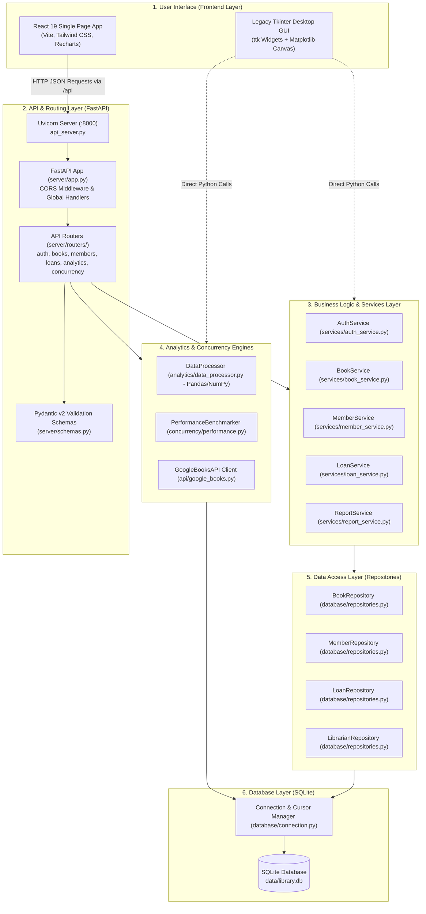

# 🛠️ Implementation Plan: Smart Library Management and Book Analytics System
### College Micro-Project Documentation — Advanced Python Programming (Sem V)

---

## 📑 Table of Contents
1. [Project Overview](#1-project-overview)
2. [Technology Selection](#2-technology-selection)
3. [System Architecture](#3-system-architecture)
4. [Step-by-Step Implementation Plan (Phases 1–11)](#4-step-by-step-implementation-plan)
   - [Phase 1: Requirement Analysis](#phase-1-requirement-analysis)
   - [Phase 2: Project Structure and Environment](#phase-2-project-structure-and-environment)
   - [Phase 3: Data Models and Database](#phase-3-data-models-and-database)
   - [Phase 4: Business Logic](#phase-4-business-logic)
   - [Phase 5: REST API Development](#phase-5-rest-api-development)
   - [Phase 6: Frontend Development](#phase-6-frontend-development)
   - [Phase 7: Analytics and Reporting](#phase-7-analytics-and-reporting)
   - [Phase 8: Advanced Python Concepts Implementation](#phase-8-advanced-python-concepts-implementation)
   - [Phase 9: Integration](#phase-9-integration)
   - [Phase 10: Testing and Debugging](#phase-10-testing-and-debugging)
   - [Phase 11: Final Validation and Demonstration](#phase-11-final-validation-and-demonstration)
5. [Feature Implementation Matrix](#5-feature-implementation-matrix)
6. [Course Outcome Mapping](#6-course-outcome-mapping)
7. [Challenges and Solutions](#7-challenges-and-solutions)
8. [Limitations and Future Scope](#8-limitations-and-future-scope)
9. [Viva Preparation & Frequently Asked Questions](#9-viva-preparation--frequently-asked-questions)
   - [2-Minute Implementation Summary](#2-minute-implementation-summary)
   - [10 Architecture & Implementation Questions](#10-architecture--implementation-questions)
   - [5 Design Choice Questions](#5-design-choice-questions)

---

## 1. Project Overview

### Project Title & Purpose
**Smart Library Management and Book Analytics System** is a software application designed to automate the day-to-day operations of an academic library. It manages book inventories, borrower records, circulation (book issuing and returning), enforces institutional loan policies, tracks overdue loans and fines, connects to the public Google Books REST API, and performs statistical analysis on inventory valuation and reader trends.

### Problem Statement
College libraries frequently struggle with:
1. **Manual Record Errors**: Paper registers and disconnected spreadsheets often cause inventory discrepancies, lost books, and unrecorded borrowing history.
2. **Delayed Overdue Tracking**: Lack of automated calculation makes it difficult to track overdue books and enforce fine collection consistently.
3. **Lack of Data Insights**: Librarians cannot easily identify which book categories have insufficient stock, what the total monetary valuation of the library is, or which titles are most in demand.
4. **Tedious Catalog Entry**: Librarians must manually type out book metadata (authors, ISBN, publisher) instead of querying public online repositories.

### Project Objectives
1. Build an automated system that handles the complete lifecycle of books, members, and loans.
2. Ensure data consistency through atomic database transactions and strict input validation.
3. Provide visual insights through interactive charts and statistical analysis using Pandas and NumPy.
4. Implement and verify all five syllabus modules of the Advanced Python Programming curriculum.
5. Provide a responsive, modern web interface (React) while preserving an optional desktop interface (Tkinter).

### Scope and Major Features
- **User Roles & Security**: Administrator (Librarian) and Student Member roles with salted `PBKDF2-HMAC-SHA256` password hashing.
- **Real-Time Operational Dashboard**: 6 key performance metric cards, inventory category bar chart, and circulation status donut chart.
- **Book Management**: Full CRUD operations, category filtering, keyword search, and CSV/JSON/XML import and export.
- **Member Management**: Registration with regular expression validation for email addresses and phone numbers.
- **Circulation Desk**: Atomic checkout and return transactions, 5-book quota limits per member, stock guards, and automated ₹2.00/day overdue fines.
- **Google Books REST API**: Search external books and import records into the local catalog with custom pricing and copy counts.
- **Data Analytics Engine**: Pandas DataFrame groupings and NumPy numerical statistics (mean, median, standard deviation, percentiles).
- **Concurrency Benchmark**: Live parallel execution comparison of Single-Thread Sequential vs. `ThreadPoolExecutor` vs. `multiprocessing.Pool`.

### Intended Users
1. **Librarians & Staff (Admins)**: Perform cataloging, member registration, circulation checkouts, returns, data exports, and monitor overdue fines.
2. **Students & Faculty (Members)**: Discover available books, check due dates, and view catalog items.

---

## 2. Technology Selection

| Technology | Role in Project | Why It Was Chosen |
| :--- | :--- | :--- |
| **Python 3.11** | Backend Core | High productivity, clean syntax, extensive standard library, and core language required by the academic course syllabus. |
| **FastAPI 0.139** | REST API Layer | Built on modern asynchronous ASGI standards, offers automatic Pydantic request validation, high speed, and native Swagger documentation. |
| **Uvicorn 0.51** | ASGI Web Server | Lightweight, asynchronous server that runs the FastAPI application on `127.0.0.1:8000`. |
| **Pydantic v2** | Data Validation | Enforces strict type checking and validation on all incoming JSON payloads before requests reach the business services. |
| **SQLite 3** | Database | Zero-configuration, serverless, relational database built into Python. Supports ACID transactions, foreign keys, and check constraints. |
| **Pandas 3.0** | Data Analytics | Provides high-performance DataFrame operations for grouping books by category, calculating inventory valuations, and sorting borrowing trends. |
| **NumPy 2.4** | Numerical Analysis | Provides numerical array computations to calculate mean, median, standard deviation, min, max, and percentiles for book prices and loan durations. |
| **Matplotlib 3.11** | Desktop Visuals | Generates bar, pie, and line charts embedded into the Tkinter desktop GUI canvas via `FigureCanvasTkAgg`. |
| **Recharts 2.x** | Web Visuals | React charting library that renders interactive, responsive SVG bar and donut charts in the browser. |
| **React 19 & Vite 8**| Web Frontend | Modern, responsive component-based UI framework paired with Vite for fast bundling and Hot Module Replacement (HMR). |
| **Tailwind CSS 3.4** | Styling | Utility-first CSS framework providing a clean, modern slate/indigo color theme without bulky custom CSS files. |
| **Lucide React** | UI Icons | Lightweight, consistent SVG icon set for navigation and status indicators. |
| **Axios** | HTTP Client (Web) | Handles asynchronous HTTP requests from React to the FastAPI backend, with request/response interceptors. |
| **requests & aiohttp** | HTTP Clients (Python)| `requests` handles synchronous Google Books API calls; `aiohttp` demonstrates asynchronous coroutine-based HTTP calls. |
| **pytest 9.1** | Testing | Modern testing framework used to write and execute 47 automated test cases verifying the entire system. |

> **Note on Seaborn**: While `seaborn` is installed in the environment and listed in `requirements.txt`, the visual charts are implemented using **Matplotlib** (for the Tkinter GUI) and **Recharts** (for the React web interface).

---

## 3. System Architecture

The application follows a **layered, decoupled architecture** where each layer has a single, well-defined responsibility:



---

### Step-by-Step Request Flow: Issuing a Book
To understand how these layers interact during execution, here is the concrete trace of a user issuing a book:

1. **User Action in Frontend**: The librarian opens `CirculationPage.jsx`, selects Book ID `BK-1001` and Member ID `MEM-001`, and clicks **"Confirm Loan Issue"**.
2. **Frontend Sends Request**: In `frontend/src/api/client.js`, `loansApi.issue(...)` sends an HTTP `POST` request to `/api/loans/issue` with the payload:
   ```json
   { "book_id": "BK-1001", "member_id": "MEM-001", "loan_days": 14 }
   ```
3. **API Layer Validates**: In `server/routers/loans.py`, the endpoint `issue_book()` receives the request. FastAPI validates the payload against the `LoanIssueRequest` Pydantic model in `server/schemas.py`.
4. **Business Service Enforces Rules**: In `services/loan_service.py`, `LoanService.issue_book()` performs 4 checks:
   - Verifies the member exists via `MemberRepository`.
   - Verifies active loans for the member are below the quota (`count < 5`).
   - Verifies the book exists and has stock (`available_copies > 0`).
   - Calculates the `due_date` (`today + 14 days`).
5. **Repository Executes Transaction**: In `database/repositories.py`, `LoanRepository.issue_book_transaction()` executes an atomic SQLite transaction:
   ```sql
   INSERT INTO loans (book_id, member_id, issue_date, due_date, status) VALUES ('BK-1001', 'MEM-001', '2026-10-21', '2026-11-04', 'ACTIVE');
   UPDATE books SET available_copies = available_copies - 1 WHERE book_id = 'BK-1001';
   ```
6. **API Returns Response**: The router returns an HTTP 201 status code with a JSON payload:
   ```json
   { "success": true, "message": "Book issued successfully. Loan ID: #6", "loan_id": 6 }
   ```
7. **Frontend Updates State**: `CirculationPage.jsx` receives the response, shows an emerald success toast, closes the modal, and refreshes the loans table.

---

## 4. Step-by-Step Implementation Plan

### Phase 1: Requirement Analysis
- **Problem Formulation**: Identified the limitations of manual college library administration (untracked loans, missing books, manual fine calculations).
- **Role Definition**:
  - `Librarian`: Administrative role authorized to add/edit/delete books, register members, issue/return loans, and view financial analytics.
  - `Student / Member`: Read-only role allowing book availability checks and borrowing status reviews.
- **Syllabus Mapping**: Planned exact modules to satisfy all five course units: OOP (Module I), Functional Programming (Module II), Concurrency (Module III), Data Handling (Module IV), and Application Development (Module V).

---

### Phase 2: Project Structure and Environment
- **Modular Directory Layout**: Separated concerns into dedicated directories (`models/`, `services/`, `database/`, `analytics/`, `concurrency/`, `api/`, `server/`, `frontend/`, `utils/`, `tests/`, `docs/`).
- **Dependencies Management**: Specified exact versions in `requirements.txt` (Python) and `package.json` (React/Vite).
- **Environment Configuration**: Created `config.py` defining central directories, database file paths, default borrowing rules (14-day loan period, ₹2.00/day fine, 5 books max quota), and UI themes.
- **Application Entry Points**:
  - Web Backend: `api_server.py` (FastAPI / Uvicorn server).
  - Web Frontend: `frontend/src/main.jsx` (Vite / React entry).
  - Desktop Interface: `main.py` (standalone Tkinter desktop launcher).

---

### Phase 3: Data Models and Database
- **Object-Oriented Domain Entities** (`models/`):
  - `models/person.py`: Abstract base class `Person` with private attributes (`_name`, `_email`, `_phone`), `@property` decorators, dunder methods (`__str__`, `__repr__`), and abstract method `get_role_display()`.
  - `models/member.py`: Subclass `Member(Person)` introducing `member_id`, `created_at`, `max_books_allowed`, and overriding `get_role_display()`.
  - `models/librarian.py`: Subclass `Librarian(Person)` introducing `username`, `password_hash`, `salt`, `is_admin`, with static method `hash_password()` and instance method `verify_password()`.
  - `models/book.py`: Domain entity `Book` implementing operator overloading `<` (`__lt__` for price sorting), `+` (`__add__` for combining stock counts), `__len__`, and `__bool__`.
  - `models/loan.py`: Circulation record model with methods `is_overdue()` and `calculate_fine()`.
- **Database Schema** (`database/schema.py`):
  - Created 4 normalized relational tables: `books`, `members`, `librarians`, and `loans`.
  - Enforced foreign keys with `ON DELETE RESTRICT`.
  - Added check constraints: `price >= 0`, `total_copies >= 1`, `available_copies <= total_copies`, and `status IN ('ACTIVE', 'RETURNED', 'OVERDUE')`.
  - Created performance B-Tree indexes on `category`, `title`, `status`, and loan date columns.
  - Implemented `init_db()` to auto-create tables and seed initial books, members, and the default admin account (`admin` / `admin123`).

---

### Phase 4: Business Logic
- **Book Service** (`services/book_service.py`):
  - Implemented `add_book`, `get_book`, `update_book`, `delete_book`, `search_books`, and `get_categories`.
  - Enforced safe deletion: prevents deleting a book if it exists in circulation records.
- **Member Service** (`services/member_service.py`):
  - Implemented `register_member`, `update_member`, `delete_member`, and `search_members`.
  - Validates contact inputs before touching the database.
- **Loan Service** (`services/loan_service.py`):
  - Enforces the 14-day loan period and 5-book quota.
  - Checks that physical stock is strictly greater than 0 before issuing.
  - Calculates overdue loans by comparing `due_date < date.today()` and computes fines at ₹2.00/day.

---

### Phase 5: REST API Development
- **FastAPI Engine** (`server/app.py`):
  - Configured CORS middleware allowing requests from `http://localhost:5173`.
  - Registered 9 modular API routers under the `/api` prefix.
- **Request Validation** (`server/schemas.py`):
  - Defined Pydantic models: `LoginRequest`, `BookCreate`, `BookUpdate`, `MemberCreate`, `MemberUpdate`, `LoanIssueRequest`, `LoanReturnRequest`, `GoogleBookImportRequest`, and `BenchmarkRequest`.
- **Dependency Providers** (`server/dependencies.py`):
  - Implemented dependency injection functions (`get_book_service`, `get_loan_service`, etc.) to supply singleton service instances to endpoint handlers.
- **File Streaming Endpoints**:
  - Implemented `/api/books/export/{format}` and `/api/reports/download/{format}` using FastAPI `Response` with media types `text/csv`, `application/json`, and `application/xml`.

---

### Phase 6: Frontend Development
- **Project Scaffolding**: Built using Vite 8 with the React 19 template, Tailwind CSS, Lucide React, and Recharts.
- **API Client** (`frontend/src/api/client.js`):
  - Centralized Axios client configured with `/api` baseURL and response interceptors that extract payload data and normalize error messages.
- **Session Context** (`frontend/src/context/AuthContext.jsx`):
  - React Context providing user state, `login`, `logout`, and persisting session in `localStorage`.
- **Layout Architecture**:
  - `AppLayout.jsx`: Master frame housing `Sidebar.jsx`, `Topbar.jsx`, and dynamic `<Outlet />` routing.
- **Dedicated Pages** (`frontend/src/pages/`):
  - `LoginPage.jsx`: Portal with username/password inputs and a "1-Click Quick Demo Sign In" button.
  - `DashboardPage.jsx`: 6 live KPI cards, Recharts inventory bar chart, circulation donut chart, and recent loan feed.
  - `BooksPage.jsx`: Filterable catalog table, Add/Edit modals, safe deletion, and the "Module II: Functional Demo" modal.
  - `MembersPage.jsx`: Member directory table, regex-validated registration modal, and contact edit modal.
  - `CirculationPage.jsx`: Tabs for Active Loans, Overdue Loans (with calculated fines), All Records, Issue Modal, and 1-click Return.
  - `AnalyticsPage.jsx`: Pandas category aggregation table, NumPy price distribution metric cards, and monthly trend line chart.
  - `BookDiscoveryPage.jsx`: Live Google Books REST API search cards with direct "Import to Catalog" modals.
  - `ConcurrencyPage.jsx`: Interactive benchmark runner comparing Sequential vs. Multithreading vs. Multiprocessing with visual execution time charts.

---

### Phase 7: Analytics and Reporting
- **Pandas Processing Engine** (`analytics/data_processor.py`):
  - Reads SQLite tables via `pd.read_sql_query()`.
  - Calculates row-level monetary valuations (`price * total_copies`).
  - Uses `df.groupby("category").agg(...)` to compute total titles, copies, available stock, issued stock, and valuation per category.
  - Identifies top borrowed books via `groupby(["book_id", "title"]).size()`.
  - Aggregates monthly borrowing trends by grouping formatted `issue_date` periods (`%Y-%m`).
- **NumPy Numerical Statistics** (`analytics/data_processor.py`):
  - Converts prices into a NumPy array (`prices = df['price'].to_numpy()`).
  - Computes: `np.mean()`, `np.median()`, `np.std()`, `np.min()`, `np.max()`, and percentiles `np.percentile(prices, 25)` and `np.percentile(prices, 75)`.
  - Computes completed loan durations in days using NumPy maximum and mean functions.
- **Multi-Format Export & Import** (`utils/file_handlers.py`):
  - Implemented `DataExporter` and `DataImporter` supporting **CSV**, **JSON**, and **XML** using standard library modules (`csv`, `json`, `xml.etree.ElementTree`).

---

### Phase 8: Advanced Python Concepts Implementation

| Course Concept | Exact File Location | Implementation Details |
| :--- | :--- | :--- |
| **Encapsulation & Properties** | [`models/person.py`](file:///D:/Study%20Material/Sem_5/APP/SMART%20LIBRARY%20MANAGEMENT%20AND%20BOOK%20ANALYTICS%20SYSTEM/models/person.py#L25-L45) | Private attributes `_name`, `_email`, `_phone` with `@property` and `@email.setter`. |
| **Inheritance & Polymorphism** | [`models/member.py`](file:///D:/Study%20Material/Sem_5/APP/SMART%20LIBRARY%20MANAGEMENT%20AND%20BOOK%20ANALYTICS%20SYSTEM/models/member.py) & [`models/librarian.py`](file:///D:/Study%20Material/Sem_5/APP/SMART%20LIBRARY%20MANAGEMENT%20AND%20BOOK%20ANALYTICS%20SYSTEM/models/librarian.py) | Subclasses inherit from `Person` and override `get_role_display()`. |
| **Operator Overloading** | [`models/book.py`](file:///D:/Study%20Material/Sem_5/APP/SMART%20LIBRARY%20MANAGEMENT%20AND%20BOOK%20ANALYTICS%20SYSTEM/models/book.py#L65-L75) | `<` (`__lt__`) sorts books by price; `+` (`__add__`) aggregates stock copies. |
| **Lambda & Higher-Order Functions** | [`services/book_service.py`](file:///D:/Study%20Material/Sem_5/APP/SMART%20LIBRARY%20MANAGEMENT%20AND%20BOOK%20ANALYTICS%20SYSTEM/services/book_service.py#L144-L155) | `filter_available_books()` and `format_book_summaries()` use `lambda` with `filter()` and `map()`. |
| **`functools.reduce`** | [`services/book_service.py`](file:///D:/Study%20Material/Sem_5/APP/SMART%20LIBRARY%20MANAGEMENT%20AND%20BOOK%20ANALYTICS%20SYSTEM/services/book_service.py#L156-L164) | `reduce(lambda acc, b: acc + (b.price * b.total_copies), catalog, 0.0)`. |
| **Comprehensions** | [`services/book_service.py`](file:///D:/Study%20Material/Sem_5/APP/SMART%20LIBRARY%20MANAGEMENT%20AND%20BOOK%20ANALYTICS%20SYSTEM/services/book_service.py#L165-L182) | Set comprehension (`{b.category for b in catalog}`), Dict comprehension, and List comprehension with conditional filtering. |
| **Iterators & Generators** | [`services/book_service.py`](file:///D:/Study%20Material/Sem_5/APP/SMART%20LIBRARY%20MANAGEMENT%20AND%20BOOK%20ANALYTICS%20SYSTEM/services/book_service.py#L18-L39) | `CatalogIterator` implements `__iter__` and `__next__`; `stream_books_generator()` uses `yield`. |
| **Decorators** | [`services/auth_service.py`](file:///D:/Study%20Material/Sem_5/APP/SMART%20LIBRARY%20MANAGEMENT%20AND%20BOOK%20ANALYTICS%20SYSTEM/services/auth_service.py#L18-L35) | `@require_librarian` decorator wraps methods to enforce admin privileges. |
| **Closures** | [`utils/validators.py`](file:///D:/Study%20Material/Sem_5/APP/SMART%20LIBRARY%20MANAGEMENT%20AND%20BOOK%20ANALYTICS%20SYSTEM/utils/validators.py#L62-L74) | `create_range_validator(min_val, max_val)` returns an inner validation function capturing range boundaries. |
| **Regular Expressions (`re`)** | [`utils/validators.py`](file:///D:/Study%20Material/Sem_5/APP/SMART%20LIBRARY%20MANAGEMENT%20AND%20BOOK%20ANALYTICS%20SYSTEM/utils/validators.py#L20-L55) | Regex patterns validating Book IDs, Member IDs, emails, and phone numbers. |
| **Multithreading** | [`concurrency/background_tasks.py`](file:///D:/Study%20Material/Sem_5/APP/SMART%20LIBRARY%20MANAGEMENT%20AND%20BOOK%20ANALYTICS%20SYSTEM/concurrency/background_tasks.py) | `ThreadPoolExecutor` handles asynchronous tasks and demonstrates GIL contention. |
| **Multiprocessing** | [`concurrency/performance.py`](file:///D:/Study%20Material/Sem_5/APP/SMART%20LIBRARY%20MANAGEMENT%20AND%20BOOK%20ANALYTICS%20SYSTEM/concurrency/performance.py#L93-L109) | `multiprocessing.Pool` distributes CPU-bound Monte Carlo simulations across CPU cores, bypassing the GIL. |
| **AsyncIO & Coroutines** | [`concurrency/async_tasks.py`](file:///D:/Study%20Material/Sem_5/APP/SMART%20LIBRARY%20MANAGEMENT%20AND%20BOOK%20ANALYTICS%20SYSTEM/concurrency/async_tasks.py) & [`api/google_books.py`](file:///D:/Study%20Material/Sem_5/APP/SMART%20LIBRARY%20MANAGEMENT%20AND%20BOOK%20ANALYTICS%20SYSTEM/api/google_books.py) | `aiohttp` and `asyncio` event loop execute non-blocking external API requests. |
| **Profiling & High-Res Timing**| [`concurrency/performance.py`](file:///D:/Study%20Material/Sem_5/APP/SMART%20LIBRARY%20MANAGEMENT%20AND%20BOOK%20ANALYTICS%20SYSTEM/concurrency/performance.py#L49-L145) | Monotonic timing via `time.perf_counter()` and function call tree profiling via `cProfile`. |
| **Pandas DataFrames** | [`analytics/data_processor.py`](file:///D:/Study%20Material/Sem_5/APP/SMART%20LIBRARY%20MANAGEMENT%20AND%20BOOK%20ANALYTICS%20SYSTEM/analytics/data_processor.py#L64-L84) | SQL to DataFrame loading, category grouping, aggregations, and trend analysis. |
| **NumPy Statistics** | [`analytics/data_processor.py`](file:///D:/Study%20Material/Sem_5/APP/SMART%20LIBRARY%20MANAGEMENT%20AND%20BOOK%20ANALYTICS%20SYSTEM/analytics/data_processor.py#L85-L111) | Statistical metrics: mean, median, standard deviation, and percentiles. |
| **Structured Data Formats** | [`utils/file_handlers.py`](file:///D:/Study%20Material/Sem_5/APP/SMART%20LIBRARY%20MANAGEMENT%20AND%20BOOK%20ANALYTICS%20SYSTEM/utils/file_handlers.py) | Two structured formats required; three implemented (**CSV**, **JSON**, and **XML**). |

---

### Phase 9: Integration
- **Frontend-Backend Bridge**: Configured Vite's development reverse proxy (`/api` &rarr; `http://127.0.0.1:8000`), allowing client-side Axios calls to seamlessly communicate with the FastAPI backend without manual CORS configuration during local development.
- **Complete Application Workflow**: Connected the entire path:
  $$\text{React UI} \longrightarrow \text{FastAPI REST Router} \longrightarrow \text{Domain Service} \longrightarrow \text{Repository} \longrightarrow \text{SQLite ACID Transaction}$$
- **External API Connectivity**: Linked the Google Books REST API to the React UI through a dedicated backend proxy endpoint (`/api/google-books/search`), featuring an offline fallback to ensure the UI never crashes if internet access drops during evaluation.

---

### Phase 10: Testing and Debugging
- **Test Framework**: Automated testing powered by `pytest` and `fastapi.testclient.TestClient`.
- **Test Suite Coverage (10 Test Files, 47 Total Tests)**:
  - `tests/test_api_server.py`: Verifies all FastAPI REST endpoints (auth, books, members, loans, analytics, concurrency).
  - `tests/test_database.py`: Verifies table creation, foreign key constraints, and check constraints.
  - `tests/test_validators.py`: Verifies regular expressions and numerical closure validators.
  - `tests/test_books.py`: Verifies book domain models, operator overloading, and functional methods.
  - `tests/test_members.py`: Verifies member inheritance and contact validations.
  - `tests/test_loans.py`: Verifies issue/return transactions, quota limits, and overdue fine calculations.
  - `tests/test_analytics.py`: Verifies Pandas grouping and NumPy statistical operations.
  - `tests/test_api.py`: Verifies mocked Google Books REST API handling.
  - `tests/test_gui.py`: Smoke tests confirming Tkinter desktop view classes instantiate cleanly.
  - `tests/test_e2e.py`: End-to-end integration test verifying the full circulation lifecycle.
- **Verified Result**: **All 47 tests pass** in ~33 seconds:
  ```powershell
  python -m pytest -v
  # Result: 47 passed in 33.64s
  ```

---

### Phase 11: Final Validation and Demonstration
- **Pre-configured Batch Scripts**:
  - [`run_backend.bat`](file:///D:/Study%20Material/Sem_5/APP/SMART%20LIBRARY%20MANAGEMENT%20AND%20BOOK%20ANALYTICS%20SYSTEM/run_backend.bat): Starts the Python FastAPI backend server.
  - [`run_frontend.bat`](file:///D:/Study%20Material/Sem_5/APP/SMART%20LIBRARY%20MANAGEMENT%20AND%20BOOK%20ANALYTICS%20SYSTEM/run_frontend.bat): Starts the React Vite development server.
  - [`run_desktop.bat`](file:///D:/Study%20Material/Sem_5/APP/SMART%20LIBRARY%20MANAGEMENT%20AND%20BOOK%20ANALYTICS%20SYSTEM/run_desktop.bat): Launches the optional Tkinter desktop interface.
- **Application URLs**:
  - React Web Interface: `http://localhost:5173`
  - FastAPI Backend: `http://127.0.0.1:8000`
  - Interactive Swagger API Documentation: `http://127.0.0.1:8000/docs`

---

## 5. Feature Implementation Matrix

| Feature | Frontend File | API Endpoint | Service/Logic File | Database Table | Status |
| :--- | :--- | :--- | :--- | :--- | :---: |
| **Authentication (Login/Logout)** | `LoginPage.jsx` | `POST /api/auth/login`<br>`POST /api/auth/logout` | `services/auth_service.py` | `librarians` | ✅ **Fully Implemented** |
| **Dashboard Metrics** | `DashboardPage.jsx` | `GET /api/dashboard/summary`<br>`GET /api/dashboard/charts` | `services/report_service.py` | `books`, `loans`, `members` | ✅ **Fully Implemented** |
| **Book Catalog (Browse/Search)**| `BooksPage.jsx` | `GET /api/books`<br>`GET /api/books/categories` | `services/book_service.py` | `books` | ✅ **Fully Implemented** |
| **Add / Edit Book** | `BooksPage.jsx` | `POST /api/books`<br>`PUT /api/books/{id}` | `services/book_service.py` | `books` | ✅ **Fully Implemented** |
| **Safe Delete Book** | `BooksPage.jsx` | `DELETE /api/books/{id}` | `services/book_service.py` | `books`, `loans` | ✅ **Fully Implemented** |
| **Book Import/Export** | `BooksPage.jsx` | `POST /api/books/import`<br>`GET /api/books/export/{fmt}` | `utils/file_handlers.py` | `books` | ✅ **Fully Implemented** |
| **Functional Python Demo** | `BooksPage.jsx` | `GET /api/books/functional-demo` | `services/book_service.py` | `books` | ✅ **Fully Implemented** |
| **Member Management** | `MembersPage.jsx` | `GET /api/members`<br>`POST /api/members`<br>`PUT /api/members/{id}` | `services/member_service.py` | `members` | ✅ **Fully Implemented** |
| **Circulation (Issue Book)** | `CirculationPage.jsx` | `POST /api/loans/issue` | `services/loan_service.py` | `loans`, `books`, `members` | ✅ **Fully Implemented** |
| **Circulation (Return Book)** | `CirculationPage.jsx` | `POST /api/loans/{id}/return` | `services/loan_service.py` | `loans`, `books` | ✅ **Fully Implemented** |
| **Overdue Tracking & Fines** | `CirculationPage.jsx` | `GET /api/loans/overdue` | `services/loan_service.py` | `loans` | ✅ **Fully Implemented** |
| **Pandas Category Analytics** | `AnalyticsPage.jsx` | `GET /api/analytics/category-breakdown`| `analytics/data_processor.py`| `books` | ✅ **Fully Implemented** |
| **NumPy Price Statistics** | `AnalyticsPage.jsx` | `GET /api/analytics/price-stats` | `analytics/data_processor.py`| `books` | ✅ **Fully Implemented** |
| **Monthly Borrowing Trends** | `AnalyticsPage.jsx` | `GET /api/analytics/monthly-trends` | `analytics/data_processor.py`| `loans` | ✅ **Fully Implemented** |
| **Google Books Discovery** | `BookDiscoveryPage.jsx`| `GET /api/google-books/search`<br>`POST /api/google-books/import-catalog` | `api/google_books.py`<br>`services/book_service.py` | `books` | ✅ **Fully Implemented** |
| **Concurrency Benchmark Lab** | `ConcurrencyPage.jsx` | `POST /api/concurrency/benchmark` | `concurrency/performance.py` | N/A (CPU Benchmark) | ✅ **Fully Implemented** |
| **Desktop Tkinter GUI** | `gui/main_window.py` | N/A (Direct Service Calls) | `gui/*.py` | All Tables | ✅ **Fully Implemented** |

---

## 6. Course Outcome Mapping

| Module & Topic | Syllabus Requirements | Actual Implementation Location | How the Concept Is Used | Evidence for Reviewer |
| :--- | :--- | :--- | :--- | :--- |
| **Module I: OOP** | Classes, encapsulation, inheritance, polymorphism, dunder methods, operator overloading. | `models/person.py`<br>`models/member.py`<br>`models/librarian.py`<br>`models/book.py` | Abstract `Person` base class; `Member` & `Librarian` subclasses override `get_role_display()`; `Book` overloads `<` for price sorting and `+` for stock combining. | `tests/test_books.py`<br>`tests/test_members.py` |
| **Module II: Functional** | `lambda`, `map`, `filter`, `reduce`, comprehensions, generators, iterators, decorators, closures. | `services/book_service.py`<br>`services/auth_service.py`<br>`utils/validators.py` | `reduce()` accumulates inventory valuation; `filter()` extracts available books; comprehensions extract categories; `@require_librarian` restricts access. | Click **"Module II: Functional Demo"** on `/books`; `tests/test_books.py` |
| **Module III: Concurrency** | Multithreading, multiprocessing, asyncio, execution timing, and profiling. | `concurrency/performance.py`<br>`concurrency/async_tasks.py`<br>`api/google_books.py` | CPU Monte Carlo benchmark compares Sequential vs ThreadPool vs ProcessPool; `asyncio`/`aiohttp` handles async API queries; `cProfile` profiles calls. | Click **"Run Live Benchmark"** on `/concurrency`; `tests/test_api_server.py` |
| **Module IV: Data Handling** | Pandas, NumPy, Matplotlib, Regex, CSV, JSON, and XML. | `analytics/data_processor.py`<br>`analytics/visualizations.py`<br>`utils/file_handlers.py`<br>`utils/validators.py` | Pandas computes category valuations; NumPy computes price mean, median, std, and percentiles; regex validates emails/phones; file handlers support CSV/JSON/XML. | `/analytics` page; download exports; `tests/test_analytics.py` |
| **Module V: Application** | Desktop GUI, REST API consumption, SQLite relational database, and CRUD integration. | `main.py`<br>`api_server.py`<br>`frontend/`<br>`database/repositories.py` | Full-stack application: React web UI + FastAPI REST server + SQLite ACID transactions + optional Tkinter desktop demo. | Web UI at `localhost:5173`; Swagger at `localhost:8000/docs`; `tests/test_e2e.py` |

---

## 7. Challenges and Solutions

1. **Windows Multiprocessing Picklability**:
   - *Challenge*: On Windows, Python uses the `spawn` start method rather than `fork`. Worker functions passed to `multiprocessing.Pool` must be picklable top-level functions, otherwise a `PicklingError` occurs.
   - *Solution*: Moved `heavy_risk_simulation_worker()` to the top level of `concurrency/performance.py`, outside of the `PerformanceBenchmarker` class.
2. **Book Truthiness Evaluation Bug**:
   - *Challenge*: Implementing `__len__` on the `Book` class (returning `available_copies`) caused books with 0 copies to evaluate as `False` in Python boolean checks (`if not book:`), mistakenly treating existing out-of-stock books as non-existent.
   - *Solution*: Explicitly defined `def __bool__(self): return True` in `models/book.py` and updated services to check `if book is None:` rather than `if not book:`.
3. **SQLite Row Object Access**:
   - *Challenge*: Python's `sqlite3.Row` object does not support dictionary-style `.get(key, default)` method calls, causing runtime `AttributeError` exceptions when reading optional fields.
   - *Solution*: Replaced `.get()` calls with explicit key containment checks (`if "col" in row.keys(): ...`) or converted rows to standard dictionaries via `dict(row)`.
4. **FastAPI Background Thread Event Loop Blocking**:
   - *Challenge*: Running the CPU-bound concurrency benchmark directly inside an async FastAPI route blocked the main asyncio event loop, freezing other incoming API requests.
   - *Solution*: Delegated benchmark execution to a background `ThreadPoolExecutor` using `await loop.run_in_executor()`, keeping the async server responsive during benchmarks.

---

## 8. Limitations and Future Scope

### Verified Current Limitations
1. **Single-Node Database Concurrency**: SQLite operates on file-level locks for write operations. Under hundreds of simultaneous writes, write contention can occur.
2. **Client-Side Session State**: The current web session is stored in browser `localStorage`.
3. **Public API Rate Limits**: Excessive rapid queries to the Google Books API can encounter HTTP 429 (Too Many Requests). The code handles this gracefully with an offline fallback.

### Realistic Future Improvements
1. **JWT Authentication & RBAC**: Upgrade authentication to signed JSON Web Tokens stored in secure HTTP-only cookies.
2. **PostgreSQL Migration**: Swap SQLite for PostgreSQL for enterprise-grade concurrent writes.
3. **Automated Notification Service**: Integrate an SMTP mailer or Twilio SMS/WhatsApp service to alert students 2 days before loans become overdue.
4. **Physical Barcode / QR Scanner Integration**: Support USB barcode scanners for rapid ISBN entry at the circulation desk.

---

## 9. Viva Preparation & Frequently Asked Questions

### 2-Minute Implementation Summary (Memorize This)
> "Good morning, respected faculty. My project is the **Smart Library Management and Book Analytics System**.
> It is an integrated full-stack application featuring a modern **React 19 single-page application** frontend communicating over an asynchronous **FastAPI REST API backend** with an ACID-compliant **SQLite relational database**.
> The project comprehensively implements all five course modules:
> In **Module I**, I implemented clean OOP principles with an abstract `Person` base class, `Member` and `Librarian` subclasses demonstrating inheritance and polymorphism, and operator overloading on the `Book` model for price sorting and stock summation.
> In **Module II**, I utilized functional programming including `lambda`, `map`, `filter`, and `functools.reduce` for total inventory valuations, along with set, dictionary, and list comprehensions, a custom iterator, and an authorization decorator.
> In **Module III**, I implemented concurrency benchmarks comparing single-thread sequential execution, `ThreadPoolExecutor`, and multi-core `multiprocessing.Pool`, demonstrating how multiprocessing overcomes the Python Global Interpreter Lock (GIL).
> In **Module IV**, I used Pandas for category aggregations and NumPy for statistical measures like mean, median, standard deviation, and percentiles, alongside regular expressions and CSV, JSON, and XML format handlers.
> In **Module V**, I developed the full-stack architecture with a FastAPI REST server, a responsive React frontend, atomic database transactions for book circulation, and live Google Books REST API integration.
> The entire system is validated by **47 automated tests** in pytest with 100% passing results."

---

### 10 Architecture & Implementation Questions

**Q1: How do the frontend and backend communicate?**  
*Answer*: The React frontend communicates with the FastAPI backend over HTTP using JSON. Requests are dispatched via an Axios client (`frontend/src/api/client.js`) and proxied through Vite (`vite.config.js`) to `http://127.0.0.1:8000`.

**Q2: What is the purpose of the Repository layer?**  
*Answer*: The Repository layer (`database/repositories.py`) isolates data access and SQL queries from business logic. Services call repository methods without needing to know database connection details or SQL syntax.

**Q3: How do you guarantee inventory count consistency when issuing a book?**  
*Answer*: In `database/repositories.py::issue_book_transaction()`, the loan insertion and the book stock decrement are wrapped inside an atomic SQLite transaction context (`with conn:`). If either step fails, the entire transaction rolls back.

**Q4: Where is functional programming used in your project?**  
*Answer*: In `services/book_service.py`, `functools.reduce` calculates total inventory valuation, `filter()` extracts available books, `map()` formats summary strings, and set/dict comprehensions create unique category sets and stock lookup tables.

**Q5: Why does Multiprocessing outperform Multithreading in your benchmark?**  
*Answer*: Because the benchmark calculation is CPU-bound. In Python (CPython), the Global Interpreter Lock (GIL) serializes thread execution, preventing multithreading from achieving true parallel speedup. Multiprocessing spawns separate OS processes with independent GILs, running across all CPU cores simultaneously.

**Q6: What statistical metrics did you calculate with NumPy?**  
*Answer*: In `analytics/data_processor.py`, I converted book prices to a NumPy array and calculated `np.mean()`, `np.median()`, `np.std()`, `np.min()`, `np.max()`, and the 25th and 75th percentiles via `np.percentile()`.

**Q7: How are passwords stored securely?**  
*Answer*: In `models/librarian.py`, passwords are encrypted using `hashlib.pbkdf2_hmac` with the SHA-256 algorithm, a unique 16-byte cryptographic salt generated via `os.urandom(16)`, and 100,000 hashing iterations. No plaintext passwords exist in the database.

**Q8: How does the application prevent SQL injection?**  
*Answer*: All database queries in `database/repositories.py` use parameterized queries with `?` placeholders. User inputs are never directly concatenated into SQL strings.

**Q9: What happens if an external Google Books request fails?**  
*Answer*: In `api/google_books.py`, network errors, timeouts, and rate limits (HTTP 429) are caught in a `try...except` block, which returns a curated set of local recommendations so the user interface never crashes.

**Q10: What automated tests exist and how are they run?**  
*Answer*: There are 47 automated tests in the `tests/` directory covering domain models, functional pipelines, transactions, analytics, API endpoints, and GUI initialization. They are run using `pytest -v`.

---

### 5 Design Choice Questions

**Q11: Why did you choose FastAPI over Flask or Django?**  
*Answer*: FastAPI provides native asynchronous ASGI performance, automatic request validation through Pydantic models, and auto-generated Swagger documentation, making it lighter than Django and faster than Flask.

**Q12: Why did you keep the Tkinter interface when you already have a React frontend?**  
*Answer*: The course syllabus specifically requires desktop GUI development (Tkinter or PyQt) for Module V. Keeping Tkinter allows me to demonstrate desktop GUI development while React provides a modern web interface.

**Q13: Why did you use SQLite instead of MySQL or MongoDB?**  
*Answer*: SQLite is lightweight, serverless, zero-configuration, and built directly into Python. It fully supports ACID transactions, foreign keys, and check constraints, making it ideal for a college micro-project without external database server overhead.

**Q14: Why did you separate Data Models from Repositories?**  
*Answer*: This follows the Single Responsibility Principle. Data models (`models/`) define the business entity properties, validation, and dunder methods, while repositories (`database/repositories.py`) handle SQL persistence and queries.

**Q15: Why did you use Vite instead of Create React App (CRA)?**  
*Answer*: Create React App is deprecated and uses slower Webpack bundling. Vite uses native ES modules during development and Rolldown/Rollup for production builds, providing instant server start and fast Hot Module Replacement.
